<!-- ============================================================
     HUSEYIN BERK BALCI — GitHub Profile · Aurora 3D Edition
     100% native SVG (isometric cubes, SMIL animations, glass panels).
     No JS, no iframes — safe for GitHub's image proxy (camo).
     Self-hosted live telemetry: .github/scripts/live_stats.py
     Kurulum: SETUP.md  ·  Yerel önizleme: preview.html
     ============================================================ -->

  

  
  
  
   
  
  

  





  



⚡ <b>Self-hosted telemetry</b> — this panel is regenerated by the profile's own <b>Aurora Autopilot</b> workflow from the live GitHub API. No third-party widget service, no downtime: real numbers, rendered as 3D SVG, every day at 02:00 UTC.





⚡ Auto-generated from live contribution data — rebuilt every day by the <b>Aurora Autopilot</b> workflow.



  
  







  
  
  
    
  

