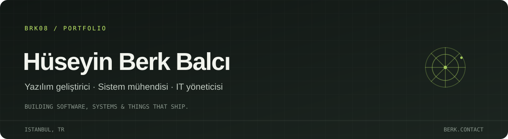

  

  <a href="https://www.berk.contact">Website</a> &nbsp;·&nbsp;
  <a href="https://github.com/BrK08?tab=repositories">Projeler</a> &nbsp;·&nbsp;
  <a href="https://takeoffturk.com">Take Off Türk</a> &nbsp;·&nbsp;
  <a href="https://kocyatcilikinsaat.com">Koç Yatçılık İnşaat</a>

## Merhaba, ben Berk.

Yazılım geliştirici, sistem mühendisi ve IT yöneticisiyim. Web projeleri geliştiriyor; yazılım, donanım ve operasyon taraflarının birlikte çalıştığı sistemlerle ilgileniyorum. Farklı diller ve araçlarla fikirleri kullanılabilir ürünlere dönüştürüyorum.

## Üzerinde çalıştıklarım

- **[Take Off Türk](https://takeoffturk.com)** — havacılık ve teknoloji odağındaki platform; ürünün geliştirilmesi ve büyütülmesi.
- **[Koç Yatçılık İnşaat](https://kocyatcilikinsaat.com)** — kurumsal web projesi.
- **OYSA · TEKNOFEST 2026** — otonom yangın müdahale aracı geliştiren ekip projesi.

## Deneyim & başarılar

- **Treysan** — IT stajı.
- **TEKNOFEST 2026 OYSA** — otonom sistemler ve yangın müdahale aracı üzerine ekip çalışması.
- Gerçek kullanıcılar için yayınlanmış ve sürdürülen web projeleri.

## Şu an

YKS'ye hazırlanıyor, OYSA projesinde çalışıyor ve Take Off Türk'ü geliştirmeye devam ediyorum. Ayrıca sistem mühendisliği ve IT operasyonları alanlarında kendimi geliştiriyorum.

## İlgi alanlarım

`Full-stack development` · `Systems engineering` · `IT administration` · `Automation` · `Product building`

  <a href="https://www.berk.contact"><strong>berk.contact ↗</strong></a>

