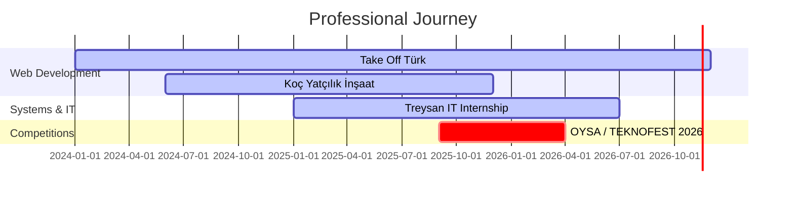

<div align="center">
<!-- Animated Header Banner -->

<br>
<!-- Typing Animation -->

<br><br>
<!-- Location & Status Badges -->


<br><br>
<!-- Social Links -->
<a href="https://takeoffturk.com" target="_blank">
  
</a>
<a href="https://kocyatcilikinsaat.com" target="_blank">
  
</a>
</div>
---
🚀 About Me
```
┌─────────────────────────────────────────────────────────────────┐
│  Hüseyin Berk Balcı — 17 | Kahramankazan, Ankara, Türkiye      │
│                                                                 │
│  ├─ 🎓 High School Graduate → Currently Preparing for YKS      │
│  ├─ 💻 Full-Stack Developer & Systems Engineer                 │
│  ├─ 🔧 IT Systems Administrator @ Treysan                      │
│  ├─ ✈️ Founder & Developer @ Take Off Türk                     │
│  └─ 🔥 TEKNOFEST 2026 — OYSA Project Lead                      │
│                                                                 │
│  "I don't just write code — I architect systems that scale."   │
└─────────────────────────────────────────────────────────────────┘
```
---
🛠️ Tech Arsenal
💻 Languages
<p>
  
  
  
  
  
  
  
  
</p>
🌐 Web Development
<p>
  
  
  
  
</p>
🖥️ Systems & Networking
<p>
  
  
  
  
  
  
</p>
🤖 Automation & Scripting
<p>
  
  
  
</p>
🎨 Design & 3D
<p>
  
  
  
</p>
---
📊 GitHub Stats
<div align="center">
  
  
</div>
<div align="center">
  
</div>
<div align="center">
  
</div>
---
🏆 GitHub Trophies
<div align="center">
  
</div>
---
🚀 Featured Projects
<table>
  <tr>
    <td width="50%">
      <h3 align="center">✈️ Take Off Türk</h3>
      <div align="center">
        <a href="https://takeoffturk.com" target="_blank">
          
        </a>
        <br><br>
        <p>Aviation news & portfolio website with Google OAuth integration and Supabase backend routing.</p>
        <p>
          
          
          
        </p>
      </div>
    </td>
    <td width="50%">
      <h3 align="center">🏗️ Koç Yatçılık İnşaat</h3>
      <div align="center">
        <a href="https://kocyatcilikinsaat.com" target="_blank">
          
        </a>
        <br><br>
        <p>Construction company web project with full development lifecycle management.</p>
        <p>
          
          
        </p>
      </div>
    </td>
  </tr>
  <tr>
    <td width="50%">
      <h3 align="center">🔥 OYSA — Autonomous Fire Vehicle</h3>
      <div align="center">
        
        <br><br>
        <p><strong>Otonom Yangın Söndürme Aracı</strong></p>
        <p>Autonomous Fire Extinguishing Vehicle for TEKNOFEST 2026 "Technology for Humanity" competition. Project design & process management.</p>
        <p>
          
          
          
        </p>
      </div>
    </td>
    <td width="50%">
      <h3 align="center">🔧 Treysan — IT Internship</h3>
      <div align="center">
        
        <br><br>
        <p>Active systems administration experience at IT department:</p>
        <ul align="left">
          <li>Hardware troubleshooting & repairs</li>
          <li>Server & network problem resolution</li>
          <li>Active Directory domain user profile management</li>
          <li>OS deployment & configuration</li>
        </ul>
      </div>
    </td>
  </tr>
</table>
---
💼 Experience Timeline

---
🎯 Current Focus
<div align="center">
🎯 Goal	📅 Timeline	🔥 Status
YKS Preparation	2025-2026	🟡 In Progress
TEKNOFEST 2026 — OYSA	2025-2026	🟢 Active
Take Off Türk Growth	Ongoing	🟢 Active
Advanced Systems Engineering	2026+	🔵 Planned
</div>
---
🌐 Connect With Me
<div align="center">
<a href="https://takeoffturk.com" target="_blank">
  
</a>
<a href="https://kocyatcilikinsaat.com" target="_blank">
  
</a>
<br><br>
<!-- Profile Views Counter -->

</div>
---
<div align="center">
<!-- Animated Footer -->

<br>
> *"The best way to predict the future is to create it."* — Peter Drucker
Made with ❤️ by Hüseyin Berk Balcı
</div>
